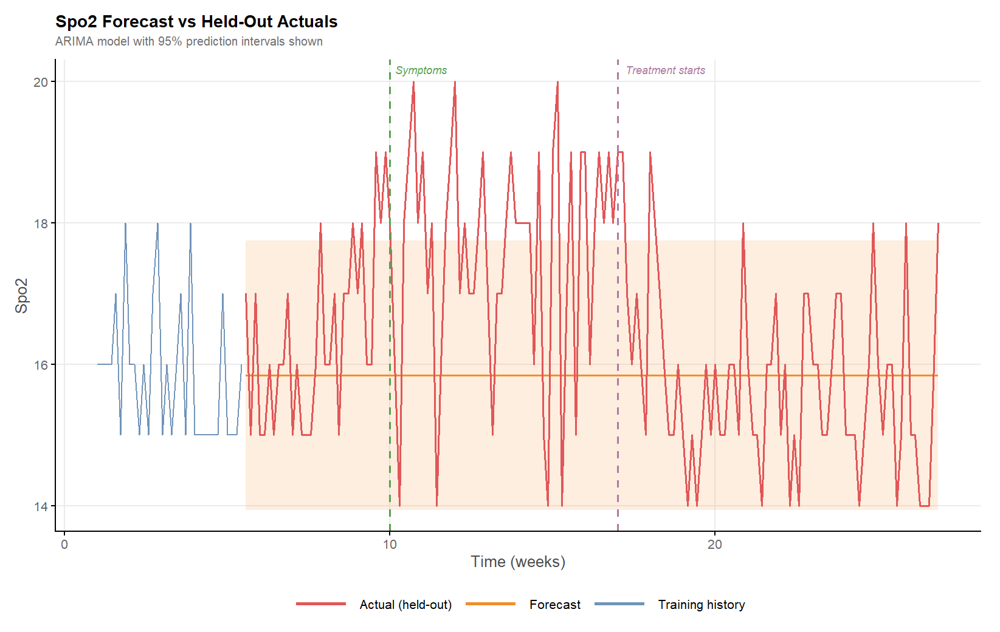
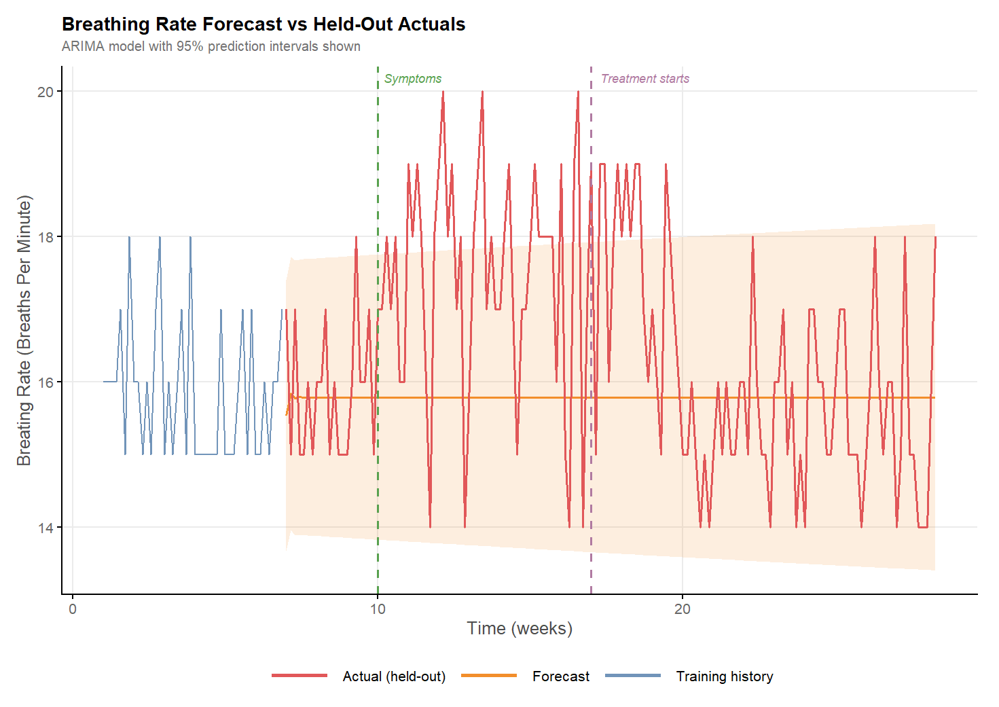
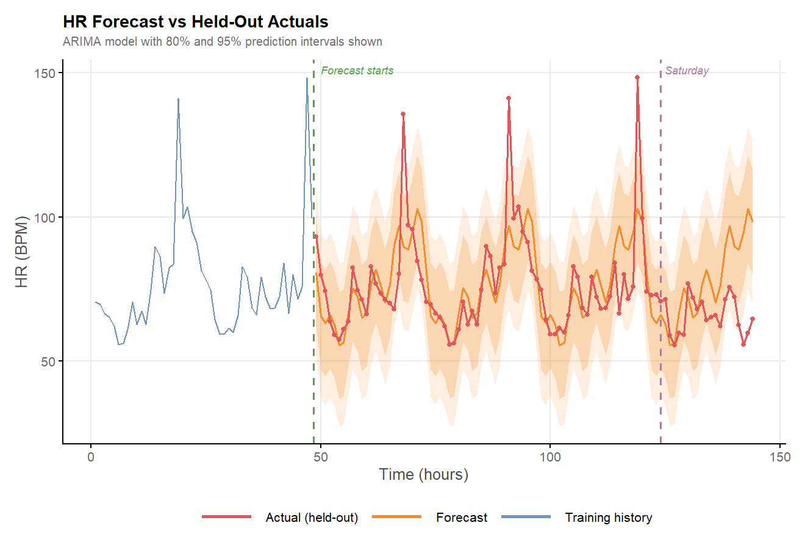
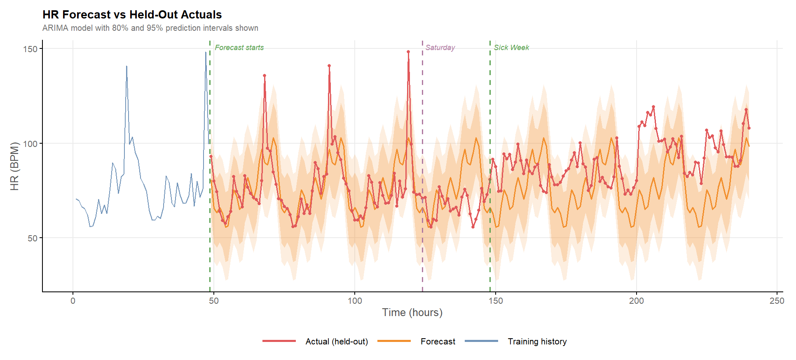

```{r setup, include=FALSE}
# This chunk configures the whole document.
# echo = FALSE hides your code so the READER sees analysis, not R syntax.
# Set echo = TRUE on any individual chunk later if you DO want to show that code.
knitr::opts_chunk$set(
  echo = FALSE,
  message = FALSE,
  warning = FALSE,
  fig.path = "figures/",   # keeps generated plot images tidy in one folder
  fig.width = 8,
  fig.height = 5,
  dpi = 150
)

# Load your packages here
# library(tidyverse)
# library(other packages you need)
```

<!--
  HOW TO USE THIS FILE
  1. Replace the placeholder text in each section with your own analysis.
  2. Knit it (the Knit button in RStudio, or rmarkdown::render("README.Rmd")).
  3. It produces README.md + a figures/ folder — commit and push BOTH.
  4. GitHub renders README.md automatically on your repo's front page.
  Delete these comment blocks before you publish.
-->

## Overview

*In November and December 2025, I became very sick. As well as feeling rubbish, my smart watch decided to digitally abuse me. Giving me constant updates that my x was out of trend and my y is not looking good. After recovering I thought I would export all the data and explore the trends.*

Post exporting, cleaning and pre-processing the data I visually explored trends in the five major criteria recorded. These included, RHR (Resting Heart Rate), HRV (Heart Rate variation),Skin Temp Variation (STV), Breathing Rate (BR) and Spo2 (Saturated Oxygen). Each data point was assessed second by second, however they are aggregated as daily trends and weekly trends (by assessing the daily averages).

Data was explored visually using standard graphing methods (line plot, scatter plot etc).Then trends were assessed via ARIMA and ITS methods, both on daily and weekly trends.

A number of trends were identified, not just in sickness and health but also baseline trends based on week day and hour were predictable for many parameters. In particular seasonal trends were identified in RHR, as this was on average higher on the weekend than other days, then it increased greatly during all days of sickness.


---

## The Data

6 Mounts of data was selected. September 01st 2025 - March 01st 2026. The purpose was to assess trends piror getting sick, September and October, during sickness November and December, then back in health January and February. 

Data was extracted via Google Takeout. This exported a huge number of JSON, text and Excel files, encompassing **daily** means and **minute-by-minute**  values for a number of variables, some more important than others. For the sake of this analysis, we exported five of the most common and important values. Each is briefly described in the table below.

**Table 1.** Smartwatch parameters and their descriptions.

| Metric | What It Measures | Typical Range |
|--------|------------------|:-------------:|
| **RHR** — Resting Heart Rate | Heartbeats per minute at complete rest; a marker of cardiovascular fitness and recovery. | 40–100 bpm |
| **HRV** — Heart Rate Variability | Beat-to-beat timing variation, reflecting autonomic nervous system balance and stress/recovery state. | 20–100 ms |
| **STV** — Skin Temperature Variation | Nightly skin temperature relative to personal baseline; can flag illness or cycle phase. | ±1–2 °C |
| **BR** — Breathing Rate | Breaths per minute, typically measured during sleep, for respiratory pattern trends. | 12–20 brpm |
| **SpO₂** — Blood Oxygen Saturation | Percentage of oxygen-carrying haemoglobin in the blood; an indicator of respiratory function. | 95–100 % |

After exporting and organising the data, missing values were imputed using KNN methods to fill in gaps where needed. However, few values required imputation, as all daily average values were complete, so weekly trends could be readily assessed. Daily values were smoothed prior to imputation: as data is recorded every second or minute, using it at that resolution is highly superfluous, so the data was smoothed minute-by-minute using a span of 61 (q = 30). This yielded values at roughly 60-minute intervals, which is sufficient for a robust analysis of daily trends.

```{r data-load}
# Load your data here
# df <- read_csv("data/smartwatch.csv")
```

```{r data-summary}
# A small, readable summary table — dimensions, key variables, date range.
# glimpse(df) or a tidy skimr::skim(df) work well and render cleanly.
```

*Note any cleaning decisions and why — dropped rows, handled missing values,
derived variables. This shows judgement, which reads as statistical maturity.*

---

## Exploratory Analysis

We begin with a visual exploration of daily average values across all five physiological parameters. The pairs plot below encodes health status through colour: observations falling within the sick period are shown in amber, whilst well periods are shown in steel blue. The lower triangle displays pairwise scatterplots for each combination of variables; the main diagonal shows the distribution of each parameter, stratified by health status; and the upper triangle summarises the pairwise correlation coefficients, again subdivided by well and sick periods.


The pairs plot reveals several notable patterns across the well (blue) and sick (amber) groups. Beginning with the main diagonal, the heart rate distribution shows a clear separation between groups, with the sick period averaging a higher HR overall. HRV follows the opposite pattern — the well period distribution sits distinctly higher, reflecting the well-established inverse relationship between resting heart rate and heart rate variability.

Turning to the scatterplots and correlation coefficients, HR shows a moderate negative correlation with both HRV (r = −0.715) and SpO₂ (r = −0.604), consistent with the physiological expectation that elevated heart rate is associated with reduced variability and slightly lower oxygen saturation during periods of illness.

The distributions are not clear-cut — many show considerable overlap between groups, with long tails extending into the opposing category. This may reflect natural biological variation, or it may be explained by confounding structure within the data. To investigate further, we examine the trends in more depth below, with particular attention to the weekday and weekend split.

**Assumptions:** *Name the assumptions your method relies on and show, briefly,
whether they hold — residual plots, normality checks, etc. Acknowledging where
they're shaky is a strength, not a weakness.*


Across all groups, heart rate is elevated during the sick period relative to the well period, and weekend values sit marginally higher than weekday values in both. The weekday–weekend difference is more pronounced in the well group than in the sick group, suggesting that illness may attenuate the typical activity-driven variation seen across the working week.

Notably, all four distributions show some degree of skew, with a sub-population of sick observations extending into the well range and vice versa. This overlap likely reflects the inherent ambiguity in the well and sick labels — the boundary between the two states is not discrete, and there is probably a transitional period at either end where physiological signals had not yet fully shifted.

We furhter investigate the trends abvoe using a multiway anova witha  interaction, assessing period and health satus as variabels. we view the results in the two table below.

<p align="center">
  
</p>

The summary statistics from the ANOVA are shown above. The p value for period is highly significant, whereas neither the weekday/weekend term nor the interaction reaches significance. This indicates that the difference visible in the raincloud plot is statistically discernible, and that it holds regardless of where in the week the measurement falls.

Below we carry out Tukey's HSD post hoc test, examining the significance of each pairwise contrast in turn. Although the interaction was not significant, the contrasts are reported for completeness, since we wanted the individual significances alongside the estimated mean differences for each effect.


<p align="center">
  
</p>

Looking at the output above, the rows of interest are row 4 (sick:weekend minus sick:weekday) and row 7 (well:weekend minus well:weekday). Row 4 gives an estimate of -0.03 with an adjusted p value of 1.00, while row 7 gives an estimate of 1.86 with an adjusted p value of 0.25. Neither contrast reaches significance, but the point estimates suggest that the usual weekday to weekend variation is attenuated during the sick period.

```{r model}
# Fit your model / run your test here.
# model <- lm(resting_hr ~ steps + age, data = df)
```

```{r model-output}
# Present results readably. broom::tidy(model) gives a clean coefficient table
# that renders much better than raw summary() output.
# library(broom); tidy(model)
```

```{r model-diagnostics}
# Diagnostic plots to back up your assumption checks.
```


## Statistical Analysis Weekly Trends

**ARIMA Background:** ARIMA — Autoregressive Integrated Moving Average — is a classical statistical framework for modelling and forecasting time series data. It captures three distinct sources of structure: the autoregressive component (AR), which models each observation as a weighted function of its own past values; the moving average component (MA), which accounts for the influence of past prediction errors; and the integration component (I), which handles non-stationarity by differencing the series until its statistical properties are stable over time. Together these components allow ARIMA to flexibly characterise a wide range of temporal patterns, from short-range day-to-day autocorrelation to longer-term trends. In the context of wearable physiological data, ARIMA is particularly well suited to modelling the persistent, autocorrelated nature of signals such as heart rate and HRV, where today's value is strongly influenced by recent history.


**ARIMA Extensions:** SARIMA - seasonal trends


**Methods:** Here we fit an ARIMA model to the daily average datapoints for heart rate. We fit the model on the first 4 weeks of data, then predict the remaining 26. We fit a standard ARIMA, with our p = 7, this will estimate seasonal trends every week, it is not the most efficient way but it is usefull

**Assumptions:** *Name the assumptions your method relies on and show, briefly,
whether they hold — residual plots, normality checks, etc. Acknowledging where
they're shaky is a strength, not a weakness.*


Four primary trends stand out from the plot above.

**1. Cyclical weekly fluctuation**  
The series oscillates regularly between higher and lower values, corresponding 
to the weekend and weekday pattern identified in the raincloud plots. This rhythm 
is well captured by the ARIMA model, before week 10 and after week 16 the 
fitted values track the observed data closely, which is encouraging given the 
model is forecasting 20 weeks beyond the fitting period.

**2. Disruption during the symptomatic window**  
Between the symptom onset and treatment markers, the model fit diverges from the 
observed data. Resting heart rate is substantially elevated during this period, 
and the cyclical weekend–weekday fluctuation is less apparent — likely attenuated 
by a higher baseline and disrupted routine.

**3. Gradual recovery post-treatment**  
Heart rate does not return immediately to the pre-illness trend following 
treatment. The transition takes several weeks, which explains the skewed 
distributions observed in the raincloud plots.

**4. Widening confidence intervals**  
The 95% confidence interval expands as the forecast horizon increases, as 
expected. Importantly however, the overall shape of the forecast is preserved 
and the observed data continues to track the mean line throughout.

The ARIMA model provides a reasonable characterisation of healthy 
heart rate behaviour, with deviations from the fitted trend serving as a potential 
marker of physiological disruption. We therefore proceed to apply the same 
modelling framework to Heart Rate Variability. Employing a 7 day seasonal trend


HRV follows a different pattern to BPM, though it still gives rise to cyclic trends. The series is noticeably less smooth than the HR data, and the two are negatively correlated. This negative correlation is evident in the pairs plot, where it returns the largest coefficient and the highest significance of any pairing. As with the trend above, the model fits the data well and continues to do so throughout the time series. Also in common with HR, the trend deviates during the period bounded by symptom onset and treatment, indicating that the ARIMA is fitting well here too.

As illustrated above, the ARIMA model describes the data well, with fitted values tracking the observed series closely, and the sick period is clearly distinguishable. Not all variables behaved this way. For several, the diagnostics indicated little exploitable autocorrelation, so a model offers no advantage over the white noise. Due to this we applied an ARIMA with 0,0,0 as its parameters, correctly identifying the lack of structure, therefore we can use the bouds to see if the data drifts out of the CI during the sick periods. Although there were models with structure that outperformed these moderately, visually they seems to be random post 4 weeks into the future. 


<details>

<summary>SPo2</summary>

Below we see the ARIMA(0,0,0) fit for the SpO2 data. Although the model identifies no exploitable temporal structure, the observed values drift outside the confidence interval during the window between symptom onset and treatment.



</details>


<details>

<summary>Breathing Rate Models</summary>

Below we fit a similar reduced model to the breathign rate data. And as above we can see that even though the strucuture is not there, the fitted data deviates out of the CI betwen the symptom window, then converges within prior and post the window. 



</details>

---

```{r model-weekly}
# Fit your model / run your test here.
# model <- lm(resting_hr ~ steps + age, data = df)

```

```{r model-output-weekly}
# Present results readably. broom::tidy(model) gives a clean coefficient table
# that renders much better than raw summary() output.
# library(broom); tidy(model)
```

```{r model-diagnostics-weekly}
# Diagnostic plots to back up your assumption checks.
```


## Statistical Analysis Daily Trends

Building on the daily averages examined above, we now take a more granular look at intra-day trends. At this resolution, signals are naturally more variable, shaped by the rhythms of daily life such as exercise, commuting, and sporadic activity due to this individual days are unlikely to be perfectly reproducible. That said, the broad patterns tend to be consistent within day-of-week: Monday exercise sessions occur at roughly the same time each week, weekend family activities cluster in similar windows, and sleep timing is relatively stable. Although this within-day variability makes modelling more challenging, the structural regularity across equivalent days justifies the exploration. Given that Heart Rate (PBM) shows the most pronounced variation across both the weekday–weekend axis and the well–sick contrast, it is the focus of the intraday analysis that follows.

Below we visualise a single day, a Tuesday. Three major peaks are visible in the raw data points. The largest sits at around 7 PM and corresponds to exercise, a second appears at about 1 PM for the lunchtime trip to the shops, and a smaller peak at roughly 7 AM reflects my commute to work. Overlaid is the smoothed mean, which captures the overall shape well, if a little flat across the larger peaks. Reducing the degree of smoothing would recover those peaks, but at the cost of a greater risk of overfitting and modelling trends that add nothing to the analysis.


From the above we choose a span to smooth the data prior fitting futher ARIMA models. We need a span that captures the shape, but is not suceptabe to every subtle kind and deviation.  


This is a poor fit. The evening exercise peak is not captured accurately, and the held-out values routinely exceed the upper prediction interval at those hours. The broader diurnal shape and general trend, however, are reproduced well. The fit could be improved in two ways: retaining more datapoints by reducing the degree of smoothing, or training on a longer run of days rather than the two used here, giving the model more cycles from which to learn the pattern.

It is also apparent that the weekend does not follow the weekday trend, reflecting a different daily routine. The window shown above is a single arbitrary week drawn from the well period, prior to illness onset.

below we fit wetend the model the the sickness data.




## Interpretation

50-124 h (baseline)

The actuals are in phase with the forecast. Overnight troughs and daytime rises line up, and most points sit inside the 80% band. The main departures are three isolated single-hour spikes (~135, ~141 and ~148 BPM at roughly 68, 91 and 119 h), spaced about a day apart, which look like bouts of activity. They fall outside the 95% interval but return to baseline immediately. They explain the RMSE/MAE ratio of about 1.5 in this window: a centred model with occasional heavy-tailed errors.

124-148 h (Saturday)

The overnight trough is still matched, but the daytime peak is mostly missing. HR stays around 55-75 BPM while the forecast climbs to about 100. This is a loss of amplitude, not a change of level, which fits a rest day with less activity. It produces the negative bias (-8 BPM) and reduced coverage in that window.

148 h onward (sick week)

Two things change at once.

Level shift. The series moves upward and stays there. There are long runs above the forecast mean, and for extended stretches (around 200-210 h, and again near 225-240 h) HR is above the upper 80% band, reaching about 110-118 BPM.
Elevated troughs. Overnight minima, which reached 55-60 BPM before, now bottom out around 73-80 BPM. This is the most persuasive feature in the plot. Night-time HR is far less confounded by activity than daytime HR, so a raised trough points to a physiological change rather than to behaviour.

The diurnal rhythm is also flattened and less regular. Peaks no longer line up cleanly with the forecast, and the day-to-night range is compressed. Together with the level shift, this is why the errors in this window are dominated by bias (Bias/MAE ≈ 0.75) and why RMSE is close to MAE: a sustained offset rather than spikes.

The errors are also clearly serially correlated. Runs above the forecast last many hours, so the 91 observations are worth much less than 91 independent pieces of evidence.

---

Below we asses the error for each of the subgroups above. as shown the "Well" period has error clustered around 0, the saturday is slightly lose with larger spread, but the sick period is much higher than 0,, and the spread is much larger. 


---

## Conclusion

*Close the loop. Return to the question from the Overview and answer it directly,
now backed by everything above. Two or three sentences. What's the takeaway?*

---

<!--
  Optional footer — tools used, data source link, contact. Keep it minimal.
-->
*Analysis conducted in R. Data source: [describe or link].*
