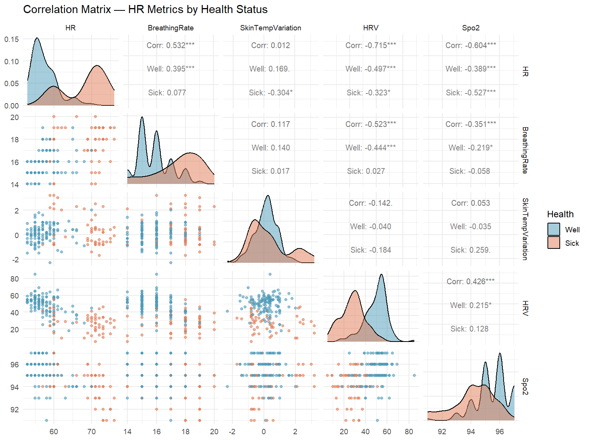
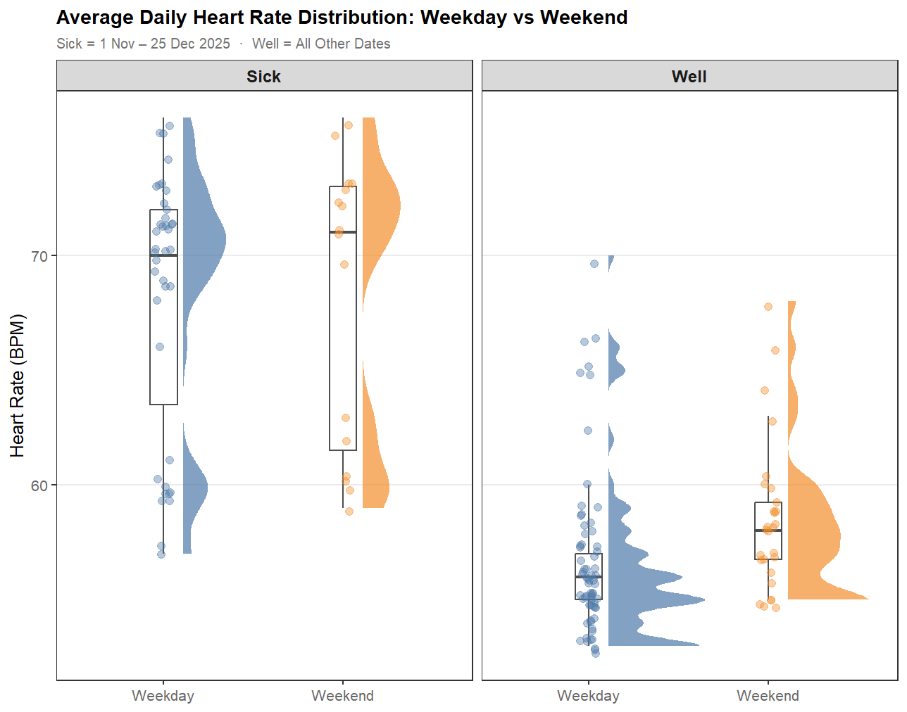
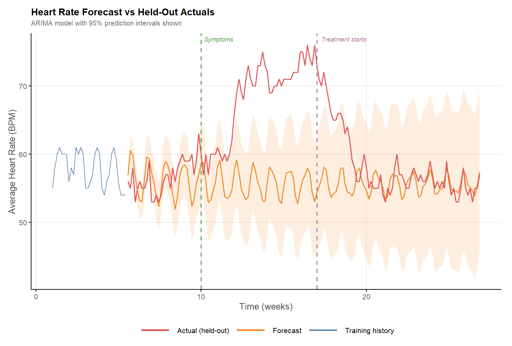
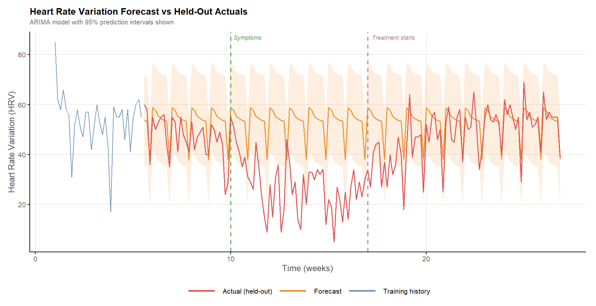
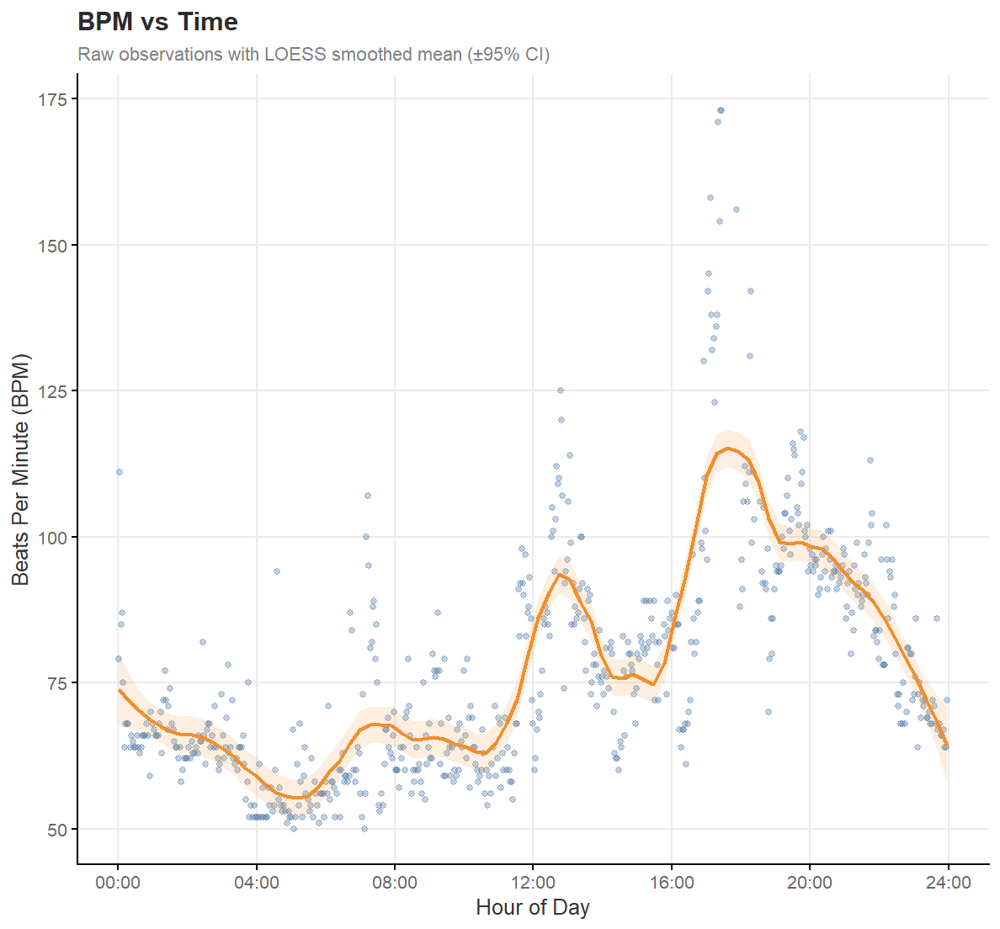

```{r setup, include=FALSE}
# This chunk configures the whole document.
# echo = FALSE hides your code so the READER sees analysis, not R syntax.
# Set echo = TRUE on any individual chunk later if you DO want to show that code.
knitr::opts_chunk$set(
  echo = FALSE,
  message = FALSE,
  warning = FALSE,
  fig.path = "figures/",   # keeps generated plot images tidy in one folder
  fig.width = 8,
  fig.height = 5,
  dpi = 150
)

# Load your packages here
# library(tidyverse)
# library(other packages you need)
```

<!--
  HOW TO USE THIS FILE
  1. Replace the placeholder text in each section with your own analysis.
  2. Knit it (the Knit button in RStudio, or rmarkdown::render("README.Rmd")).
  3. It produces README.md + a figures/ folder — commit and push BOTH.
  4. GitHub renders README.md automatically on your repo's front page.
  Delete these comment blocks before you publish.
-->

## Overview

*In November and December 2025, I became very sick. As well as feeling rubbish, my smart watch decided to digitally abuse me. Giving me constant updates that my x was out of trend and my y is not looking good. After recovering I thought I would export all the data and explore the trends.*

Post exporting, cleaning and pre-processing the data I visually explored trends in the five major criteria recorded. These included, RHR (Resting Heart Rate), HRV (Heart Rate variation),Skin Temp Variation (STV), Breathing Rate (BR) and Spo2 (Saturated Oxygen). Each data point was assessed second by second, however they are aggregated as daily trends and weekly trends (by assessing the daily averages).

Data was explored visually using standard graphing methods (line plot, scatter plot etc).Then trends were assessed via ARIMA and ITS methods, both on daily and weekly trends.

A number of trends were identified, not just in sickness and health but also baseline trends based on week day and hour were predictable for many parameters. In particular seosanal trends were identified in RHR, as this was on average higher on the weeked than other days, then it increased greatly durinf all days during sickness.


**The question:** e.g. *Does step count meaningfully predict resting heart rate,
and does that relationship differ by age group?*


---

## The Data

6 Mounts of data was selected. September 01st 2025 - March 01st 2026. The purpose was to assess trends piror getting sick, September and October, during sickness November and December, then back in health January and February. 

Data was extracted via Google Takeout. This exported a huge number of JSON, text and Excel files, encompassing **daily** means and **minute-by-minute**  values for a number of variables, some more important than others. For the sake of this analysis, we exported five of the most common and important values. Each is briefly described in the table below.

**Table 1.** Smartwatch parameters and their descriptions.

| Metric | What It Measures | Typical Range |
|--------|------------------|:-------------:|
| **RHR** — Resting Heart Rate | Heartbeats per minute at complete rest; a marker of cardiovascular fitness and recovery. | 40–100 bpm |
| **HRV** — Heart Rate Variability | Beat-to-beat timing variation, reflecting autonomic nervous system balance and stress/recovery state. | 20–100 ms |
| **STV** — Skin Temperature Variation | Nightly skin temperature relative to personal baseline; can flag illness or cycle phase. | ±1–2 °C |
| **BR** — Breathing Rate | Breaths per minute, typically measured during sleep, for respiratory pattern trends. | 12–20 brpm |
| **SpO₂** — Blood Oxygen Saturation | Percentage of oxygen-carrying haemoglobin in the blood; an indicator of respiratory function. | 95–100 % |

After exporting and organising the data, missing values were imputed using KNN methods to fill in gaps where needed. However, few values required imputation, as all daily average values were complete, so weekly trends could be readily assessed. Daily values were smoothed prior to imputation: as data is recorded every second or minute, using it at that resolution is highly superfluous, so the data was smoothed minute-by-minute using a span of 61 (q = 30). This yielded values at roughly 60-minute intervals, which is sufficient for a robust analysis of daily trends.

```{r data-load}
# Load your data here
# df <- read_csv("data/smartwatch.csv")
```

```{r data-summary}
# A small, readable summary table — dimensions, key variables, date range.
# glimpse(df) or a tidy skimr::skim(df) work well and render cleanly.
```

*Note any cleaning decisions and why — dropped rows, handled missing values,
derived variables. This shows judgement, which reads as statistical maturity.*

---

## Exploratory Analysis

We begin with a visual exploration of daily average values across all five physiological parameters. The pairs plot below encodes health status through colour: observations falling within the sick period are shown in amber, whilst well periods are shown in steel blue. The lower triangle displays pairwise scatterplots for each combination of variables; the main diagonal shows the distribution of each parameter, stratified by health status; and the upper triangle summarises the pairwise correlation coefficients, again subdivided by well and sick periods.




The pairs plot reveals several notable patterns across the well (blue) and sick (amber) groups. Beginning with the main diagonal, the heart rate distribution shows a clear separation between groups, with the sick period averaging a higher HR overall. HRV follows the opposite pattern — the well period distribution sits distinctly higher, reflecting the well-established inverse relationship between resting heart rate and heart rate variability.

Turning to the scatterplots and correlation coefficients, HR shows a moderate negative correlation with both HRV (r = −0.715) and SpO₂ (r = −0.604), consistent with the physiological expectation that elevated heart rate is associated with reduced variability and slightly lower oxygen saturation during periods of illness.

The distributions are not clear-cut — many show considerable overlap between groups, with long tails extending into the opposing category. This may reflect natural biological variation, or it may be explained by confounding structure within the data. To investigate further, we examine the trends in more depth below, with particular attention to the weekday and weekend split.

**Assumptions:** *Name the assumptions your method relies on and show, briefly,
whether they hold — residual plots, normality checks, etc. Acknowledging where
they're shaky is a strength, not a weakness.*




Across all groups, heart rate is elevated during the sick period relative to the well period, and weekend values sit marginally higher than weekday values in both. The weekday–weekend difference is more pronounced in the well group than in the sick group, suggesting that illness may attenuate the typical activity-driven variation seen across the working week.

Notably, all four distributions show some degree of skew, with a sub-population of sick observations extending into the well range and vice versa. This overlap likely reflects the inherent ambiguity in the well and sick labels — the boundary between the two states is not discrete, and there is probably a transitional period at either end where physiological signals had not yet fully shifted.

TODO - ANOVA OF THE WELL *SICK * DAY droups
```{r model}
# Fit your model / run your test here.
# model <- lm(resting_hr ~ steps + age, data = df)
```

```{r model-output}
# Present results readably. broom::tidy(model) gives a clean coefficient table
# that renders much better than raw summary() output.
# library(broom); tidy(model)
```

```{r model-diagnostics}
# Diagnostic plots to back up your assumption checks.
```


## Statistical Analysis Weekly Trends

*The core. Be explicit about your reasoning — this section separates "can use R"
from "can think statistically."*

**Approach:** *State which method you're using and, crucially, WHY it fits this
question and this data (e.g. why a linear model, why this test).*

**Assumptions:** *Name the assumptions your method relies on and show, briefly,
whether they hold — residual plots, normality checks, etc. Acknowledging where
they're shaky is a strength, not a weakness.*




---

```{r model-weekly}
# Fit your model / run your test here.
# model <- lm(resting_hr ~ steps + age, data = df)

```

```{r model-output-weekly}
# Present results readably. broom::tidy(model) gives a clean coefficient table
# that renders much better than raw summary() output.
# library(broom); tidy(model)
```

```{r model-diagnostics-weekly}
# Diagnostic plots to back up your assumption checks.
```


## Statistical Analysis Daily Trends

Building on the daily averages examined above, we now take a more granular look at intraday trends. At this resolution, signals are naturally more variable — shaped by the rhythms of daily life such as exercise, commuting, and occupational activity — and individual days are unlikely to be perfectly reproducible. That said, the broad patterns tend to be consistent within day-of-week: Monday exercise sessions occur at roughly the same time each week, weekend family activities cluster in similar windows, and sleep timing is relatively stable. Although this within-day variability makes modelling more challenging, the structural regularity across equivalent days justifies the exploration. Given that BPM shows the most pronounced variation across both the weekday–weekend axis and the well–sick contrast, it is the focus of the intraday analysis that follows.




**Approach:** *State which method you're using and, crucially, WHY it fits this
question and this data (e.g. why a linear model, why this test).*

**Assumptions:** *Name the assumptions your method relies on and show, briefly,
whether they hold — residual plots, normality checks, etc. Acknowledging where
they're shaky is a strength, not a weakness.*
---

```{r model-daily}
# Fit your model / run your test here.
# model <- lm(resting_hr ~ steps + age, data = df)
```

```{r model-output-daily}
# Present results readably. broom::tidy(model) gives a clean coefficient table
# that renders much better than raw summary() output.
# library(broom); tidy(model)
```

```{r model-diagnostics-daily}
# Diagnostic plots to back up your assumption checks.
```

## Interpretation

*Translate the numbers into meaning. For each key result: what does it say in
plain English, is it practically (not just statistically) significant, and how
confident are you? This is the paragraph a non-statistician should be able to
follow.*

*Be honest about limitations — sample size, confounders, what you couldn't test.
Naming what you'd do with more data or time shows you understand the boundaries
of your own analysis.*

---

## Conclusion

*Close the loop. Return to the question from the Overview and answer it directly,
now backed by everything above. Two or three sentences. What's the takeaway?*

---

<!--
  Optional footer — tools used, data source link, contact. Keep it minimal.
-->
*Analysis conducted in R. Data source: [describe or link].*
